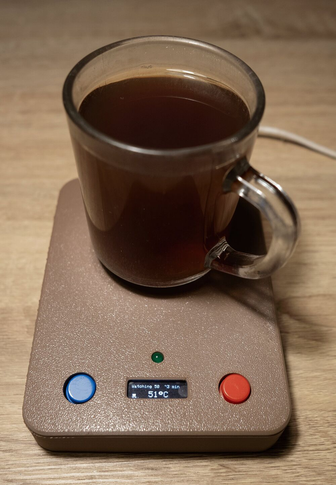
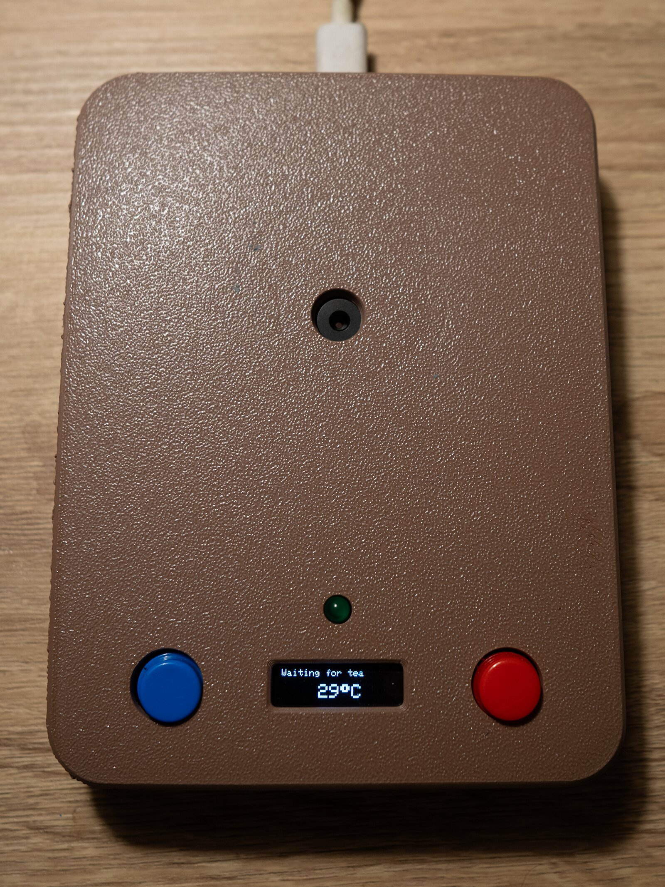

# MonTea


Short for Monitor Tea.

> PL: Małe urządzenie, które pilnuje herbaty i piszczy, gdy wystygnie do
> wybranej temperatury. Czujnik podczerwieni mierzy dno kubka, więc nic nie
> dotyka herbaty.

A small device that watches your tea and beeps when it has cooled down enough
to drink. An IR sensor in the case points up at the bottom of the cup, so
nothing touches the tea. You don't press anything: put a hot cup on it and it
starts watching by itself.

It's a working prototype that I built and use on my desk. The firmware and
the logic tests are in this repo. The enclosure files aren't (see
[Enclosure](#enclosure)).

<table>
  <tr>
    <td></td>
    <td></td>
  </tr>
  <tr>
    <td align="center">Watching a cup</td>
    <td align="center">Waiting, with the sensor in the middle</td>
  </tr>
</table>

## Hardware

- Waveshare RP2040-Zero
- MLX90614 IR temperature sensor
- SSD1306 OLED, 128x32, I2C
- Active-low buzzer (pin low = sound)
- 2 buttons that read LOW at rest and HIGH when pressed. For buttons wired
  from the pin to GND instead, set `BUTTON_PRESSED_LEVEL` in `src/main.cpp` to
  `LOW`
- LED with a resistor for the error signal (optional, the screen shows faults
  too)

### Wiring

| Part            | RP2040-Zero pin |
| --------------- | --------------- |
| OLED SDA        | GP0             |
| OLED SCL        | GP1             |
| MLX90614 SDA    | GP0             |
| MLX90614 SCL    | GP1             |
| Buzzer          | GP14            |
| Error LED       | GP5             |
| Left button     | GP26            |
| Right button    | GP27            |

## Enclosure

The case in the photos is 3D printed in PLA. I wouldn't do that again: the
bottom of a hot cup can reach 60-70 °C, and PLA starts to soften around 60 °C.
Use PETG, or better ASA.

I left the STL files out on purpose. Some dimensions in my model were assumed
instead of measured, and after printing I had to fix the fit with hot glue, so
the design isn't worth copying. If you build your own case, measure your
modules first. The parts that matter most are the sensor can height, the
button bodies, and the position of the sensor hole, which has to sit in the
middle of where the cup stands.

## How it behaves

| Screen            | What is happening                       |
| ----------------- | --------------------------------------- |
| `Waiting for tea` | Idle, stays quiet at any temperature    |
| `Watching 50`     | Hot cup arrived, 50 is the target       |
| `Cup lifted`      | You took the cup away (see below)       |
| `Tea is ready!`   | At the target, beeping                  |
| `Sensor error`    | No good reading for 2 seconds, retrying |
| `Set target`      | Editing a setting                       |

- Watching starts by itself when the reading jumps by 3 degrees within a few
  seconds and stays up for 3 seconds. That's what a cup arriving looks like,
  so it works at any target. A cup that was already standing there, or slow
  warming, doesn't start it.
- If you lift the cup and put it back above the target, watching goes on. If
  it comes back at or below the target, the alarm goes off. After 10 minutes
  away it gives up.
- For 10 minutes after an alarm, only a cup above the target starts watching,
  so putting your cup back after a sip doesn't set it off again.
- After about a minute of watching, the top line adds an estimate like `~7 min`.
- The alarm goes off when the tea has been at or below the target for 3
  seconds and the reading has dropped half a degree from its peak. A glass
  warms up slowly, so a cup that arrives already below the target only beeps
  once it starts cooling.
- The alarm stops when you press any button, pick up the cup, or after a minute.
- The screen turns off after 5 idle minutes. A button press or a hot cup wakes
  it up.
- The green error LED blinks once for half a second at power-up as a self-test.
  After that it's on while the `Sensor error` screen shows and goes off when
  readings come back. If it stays on from boot and the screen is blank, the
  display wasn't found.

## Buttons

- Any press opens the target setting. The first press doesn't change anything.
- While editing, left lowers the target and right raises it, 1 degree at a
  time. Hold to repeat. The target can be set from 20 to 90 °C.
- Hold both for a second to switch to the calibration offset.
- During the alarm, any press stops it.

Settings close and save by themselves 5 seconds after the last press.

## Calibration

You can usually skip this and leave the offset at 0.

The sensor measures the bottom of the cup, and the cup cools differently from
the tea inside it. So don't try to match the reading to a thermometer stuck in
the tea. The offset is only there in case the sensor itself reads wrong. To
check it, take an empty cup that has been sitting at room temperature, hold
both buttons for a second and adjust the offset until the reading matches a
room thermometer.

To make it fit your cup, change the target instead. The default of 50 works
for my glass cup. For anything else, taste a few cups and set what you like.

## Placing the cup

- Stand the cup in the middle of the sensor hole. Off to the side, the sensor
  also sees the case around it and reads low.
- IR doesn't pass through glass, so even with a glass cup the sensor reads the
  glass, not the tea.
- A cup with a thick or hollow base reads lower and reacts later than the tea
  inside. A flat, thin bottom works best.
- Polished metal reflects IR instead of emitting it, so it reads much colder
  than it is. Glass and ceramic are fine, the bottom of a steel mug isn't.
- Keep the sensor hole clean. A drop of tea on the sensor throws the reading
  off.

## Building

This is a [PlatformIO](https://platformio.org/) project.

```
pio run -t upload       # build and flash
pio test -e native      # run the logic tests on the PC, needs gcc on the PATH
```

The logic that decides when to beep lives in `lib/TeaCore` and has no Arduino
code in it, which is why the tests run on a PC. The timings and margins are
constants at the top of each class. I picked them as reasonable guesses and
haven't tuned them against measurements yet.

Uncomment `#define DEBUG` in `src/main.cpp` for serial output. The board then
waits for a USB serial connection at boot.

## Notes

You don't need to change anything here for the wiring above to work.

The MLX90614 is limited to 100 kHz, so on the shared bus the display runs at
100 kHz too, and the sensor still sees every frame. If you get sensor errors
or odd readings, connect the sensor to its own bus (SDA to GP2, SCL to GP3)
and set `MLX_ON_OWN_BUS` to `1` at the top of `src/main.cpp`. The display then
gets its full 400 kHz.

The RGB LED on the board (GP16) shows the state too, but in my build it's
hidden inside the case. If your board is visible, it works as is: amber while
watching or with the cup lifted, green when the tea is ready, red on a sensor
error, blue while editing a setting, and off while waiting. The colour order is
`NEO_RGB`. If red and green look swapped on your board, change it to `NEO_GRB`
in `src/main.cpp`.

## What I learned

I designed the enclosure from datasheet and shop dimensions. Several were off
by a millimetre or two, which is enough to stop a button or the sensor from
fitting. Next time I'll measure every module with calipers and print a small
test piece before the full case.

My first idea was to calibrate against a thermometer in the tea. That makes no
sense, because the sensor never sees the tea. Now the offset only corrects the
sensor, and the target is just a matter of taste.

## License

MIT, see [LICENSE](LICENSE).